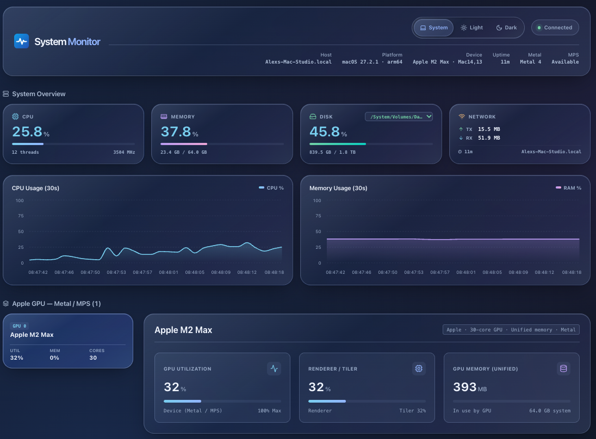

# System Monitor

A sleek, modern, Liquid Glass–styled real-time system & GPU monitoring dashboard that runs on **macOS, Linux and Windows**.
Built with **Next.js (React/TypeScript)** for the frontend and **FastAPI (Python)** for the backend, which streams telemetry over a WebSocket. A single `./start.sh` picks the right deployment for each OS (Docker Compose on Linux, native backend on macOS / Windows).



---

## Supported Platforms

| | **macOS** | **Linux** | **Windows** |
| --- | --- | --- | --- |
| Launcher | `./start.sh` (bash/zsh) | `./start.sh` | `./start.sh` from **Git Bash** |
| Backend | Native Python venv | Docker (`pid: host`) | Native Python venv |
| Frontend | Docker, or native `npm` fallback | Docker | Docker, or native `npm` fallback |
| GPU | Apple GPU — Metal / MPS (`ioreg`) | NVIDIA via NVML (auto GPU passthrough) | NVIDIA via NVML |
| Disks shown | Data volume + `/Volumes/*` (external / USB) | Every host block device, incl. USB (via `/proc/1/mounts`) | Every drive letter (`C:\`, `D:\` …) |
| CPU temperature | — (needs root) | ✓ (where `lm-sensors`/hwmon exposes it) | — (not exposed by psutil) |
| *Background* process filter | ✓ | ✓ | — (no controlling-terminal concept; every process is flagged background) |
| Requirements | Python 3.9+, Docker Desktop *or* Node.js | Docker + Docker Compose (+ NVIDIA Container Toolkit for GPU) | Git Bash, Python 3.9+, Docker Desktop *or* Node.js |

> **Why is the backend native on macOS / Windows?** Docker Desktop runs containers inside a Linux VM, so a containerized backend would only see that VM — not the real OS, the Apple GPU, the host's disks or its processes.

---

## Features
- **Platform Detection**: Detects the host OS (**Linux / macOS / Windows**), version, architecture, device model and the real **host name** (even inside the Linux container) and shows them in the header — e.g. `macOS 15.1 · arm64`, `Apple M2 Max · Mac14,13`.
- **System Overview**: Real-time CPU usage (with temperature where the OS exposes it), RAM/swap, disk usage and network I/O — updated every second.
- **All Drives, One Card**: Every disk — internal, external and USB — is listed. Pick a drive from the **dropdown** in the disk card header; it falls back to the primary drive (`/`, the macOS Data volume or `%SystemDrive%`) if the selected one is unplugged. Removable drives without media are skipped.
- **NVIDIA GPU Monitoring (Linux / Windows)**: Core utilization, VRAM, temperature, fan speed, power draw and CUDA/Graphics processes via NVML.
- **Apple GPU Monitoring — Metal / MPS (macOS)**: Device / renderer / tiler utilization, GPU memory in use (unified memory), Metal support level, MPS availability, and **per-process GPU time** for every Metal/MPS client (e.g. PyTorch `mps` jobs) — read from the IOKit registry, no `sudo` needed.
- **All Processes incl. Background**: Every process visible to the user, with a *Background* filter for processes without a controlling terminal (daemons, launchd/systemd services, `nohup` / detached jobs).
- **Process Management & Termination (Kill)**: Terminate any GPU or system process (`SIGTERM` / `SIGKILL`; terminate/kill on Windows) from the web UI with a confirmation modal. PID ≤ 1 and the backend itself are protected.
- **Light / Dark / System Themes**: Tinted *Liquid Glass* look with a theme switcher in the header; the choice is remembered in the browser and a themed loading screen is shown until the first telemetry arrives.
- **Rolling Time-series Charts**: 30-second history for CPU, memory, GPU utilization and GPU memory.
- **Smart Port Fallback**: `./start.sh` picks free ports automatically (3000/8000 → 3001/8001 …) and hands them to the frontend at runtime — no rebuild needed.
- **Real data only**: There is no mock/simulated mode. A metric the platform does not expose (e.g. Apple GPU temperature/power, which require root) is simply not displayed; without a supported GPU the GPU section is hidden.

---

## Quick Start (Recommended)

```bash
./start.sh     # start
./stop.sh      # stop
```

Then open the dashboard URL printed by the script (default [http://localhost:3000](http://localhost:3000)).

### macOS
```bash
./start.sh
```
- Creates `backend/.venv` on first run and reinstalls Python dependencies only when `backend/requirements.txt` changes.
- Starts the backend natively (log: `.run/backend.log`) and the frontend in Docker Desktop, or natively with `npm` (`next build` + `next start`) if Docker isn't running.

### Linux
```bash
./start.sh
```
- Builds and starts both containers with Docker Compose. The backend runs with `pid: host` and the `KILL` / `SYS_PTRACE` capabilities so it can see and terminate host processes and read host disks.
- If `nvidia-smi` works **and** the NVIDIA container runtime is installed, `docker-compose.gpu.yml` is layered on automatically for GPU passthrough. Otherwise the GPU section is hidden.
- Docker is required on Linux; the script exits if the daemon isn't reachable.

### Windows
Run from **Git Bash** (comes with [Git for Windows](https://git-scm.com/download/win)), not PowerShell/CMD or WSL:
```bash
./start.sh
```
- Same native flow as macOS: venv in `backend/.venv`, backend runs natively, frontend in Docker Desktop or native `npm`.
- `./stop.sh` kills the whole backend process tree (`taskkill /T`), because the venv's `python.exe` is only a launcher for the real interpreter.
- NVIDIA GPUs are picked up automatically when the NVIDIA driver (NVML) is installed.

Native runtime state (PID files, `backend.log`, `frontend.log`) is kept in `.run/`.

---

## Manual Docker Compose Launch (Linux only)

```bash
# Without NVIDIA GPU
docker compose up -d --build

# With NVIDIA GPU (requires NVIDIA driver + NVIDIA Container Toolkit)
docker compose -f docker-compose.yml -f docker-compose.gpu.yml up -d --build
```
- **Frontend Dashboard**: [http://localhost:3000](http://localhost:3000)
- **Backend API**: [http://localhost:8000](http://localhost:8000)
- **API Health Check**: [http://localhost:8000/api/health](http://localhost:8000/api/health) — reports the detected platform and GPU backend (`nvml`, `metal` or `null`).

> Don't use Docker for the backend on macOS / Windows — it would report the Docker Desktop VM instead of your machine.

---

## Environment Variables

All configuration lives in `.env` in the project root (`start.sh` creates it from `.env.example` and rewrites the ports if they are taken).

| Variable | Default | Description |
| --- | --- | --- |
| `BACKEND_PORT` | `8000` | Host port for the FastAPI backend. |
| `FRONTEND_PORT` | `3000` | Host port for the Next.js frontend. |
| `NEXT_PUBLIC_WS_URL` | *(empty)* | WebSocket URL for telemetry. If empty, the frontend connects to the current browser host on `BACKEND_PORT`. Example: `ws://192.168.1.100:8000/ws`. |

### Setting up `.env`

```bash
cp .env.example .env     # optional — start.sh does this for you on first run
```

**Example 1 — default (local machine).** Nothing to change; leave `NEXT_PUBLIC_WS_URL` empty and the browser connects to the same host it loaded the dashboard from:

```dotenv
FRONTEND_PORT=3000
BACKEND_PORT=8000
NEXT_PUBLIC_WS_URL=
```

**Example 2 — custom ports with manual Docker Compose (Linux).** `docker compose` reads `.env` directly:

```dotenv
FRONTEND_PORT=8080
BACKEND_PORT=9000
NEXT_PUBLIC_WS_URL=
```
```bash
docker compose up -d --build    # dashboard: http://localhost:8080, API: http://localhost:9000
```

**Example 3 — fixed WebSocket endpoint** (e.g. the dashboard is opened through a reverse proxy or from another machine and the backend lives at a specific address):

```dotenv
FRONTEND_PORT=3000
BACKEND_PORT=8000
NEXT_PUBLIC_WS_URL=ws://192.168.1.100:8000/ws    # use wss://… behind HTTPS
```

> **Note:** `./start.sh` always searches for free ports starting at 3000 / 8000 and **overwrites** `FRONTEND_PORT` / `BACKEND_PORT` in `.env`, so custom port values only stick when you launch with Docker Compose or the native commands yourself. `NEXT_PUBLIC_WS_URL` is preserved and used by `start.sh`. Re-run `./start.sh` (or restart the containers) after editing `.env`.

---

## Platform Notes

### macOS (Apple GPU — Metal / MPS)
- GPU metrics come from the `IOAccelerator` IOKit registry (`ioreg`), the same source Activity Monitor uses. MPS workloads execute on the GPU through Metal, so they show up in GPU utilization and as *Metal* clients in **GPU Workloads**.
- **GPU Time** per process = share of GPU execution time over the last 1 s sample (first sample shows `—`).
- GPU memory is *unified* memory; the card shows memory currently in use by the GPU against total system RAM.
- Not shown on macOS (requires root / `powermetrics`): GPU temperature, power draw, fan speed and per-process GPU memory.
- CPU temperature is not exposed to unprivileged processes on macOS and is therefore hidden.
- Disks: only the Data volume (`/System/Volumes/Data`) and `/Volumes/*` are listed — the other APFS system volumes share the same space.

### Linux (NVIDIA)
- Requires the NVIDIA driver (NVML) and, for the Docker setup, the NVIDIA Container Toolkit. Without an NVIDIA GPU the GPU section is hidden and only system metrics/processes are shown.
- Disks are read from the host's mount table (`/proc/1/mounts` through `pid: host`), so host disks and USB drives appear rather than the container's bind mounts. Loop/snap, tmpfs, overlay and network filesystems are skipped.
- The host's `/etc/hostname` is bind-mounted read-only so the header shows the machine name instead of the container ID.

### Windows (NVIDIA)
- Requires the NVIDIA driver (NVML) for GPU metrics; without it the GPU section is hidden.
- Every drive letter is listed; `%SystemDrive%` (usually `C:\`) is the default selection.
- CPU temperature isn't available, and the *Background* filter isn't meaningful (Windows processes have no controlling terminal).
- Terminating processes owned by other users or services may require running Git Bash as Administrator.

---

## Local Development (No Docker)

### Backend (Python FastAPI)
```bash
cd backend
python -m venv .venv
source .venv/bin/activate          # Windows (Git Bash): source .venv/Scripts/activate
pip install -r requirements.txt
python main.py                     # honors $PORT (default 8000)
```
On macOS / Windows always run the backend this way (natively), not in Docker.

### Frontend (Next.js)
```bash
cd frontend
npm install
npm run dev                        # http://localhost:3000
npm run lint                       # ESLint
npx tsc --noEmit                   # type-check (next build ignores TS/ESLint errors)
```
If the backend isn't on port 8000, set `BACKEND_PORT` (or `NEXT_PUBLIC_WS_URL`) in the frontend's environment.
